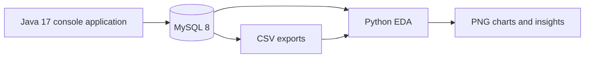

# Online Job Portal and Employment Trend Analysis System

Academic project (Scenario 22) for placement-cell operations and evidence-based employment trend analysis.

## Repository layout
`database/` holds schema, seed data and 12 reporting queries; `java-app/` is the Maven JDBC application; `python-analysis/` is the ETL/EDA pipeline; `docs/` holds SRS/design/test evidence; `data/exports/` is the optional offline analysis input.

## Setup and run

1. MySQL: execute `database/schema.sql`, then `database/seed_data.sql`, then inspect `database/queries.sql`. The seed creates 6 departments, 10 companies, 40 vacancies, 100 students and 360 applications over 2024–2026.
2. Java: copy/update `java-app/src/main/resources/db.properties`, then run `mvn test` and `mvn package` from `java-app`; start `edu.portal.ui.ConsoleApp`.
3. Python: create a virtual environment, install `python-analysis/requirements.txt`, copy `.env.example` to `.env` and set `DATABASE_URL`, then run `python main.py` in `python-analysis`. Without a database, place `student.csv`, `vacancy.csv`, `application.csv`, `company.csv`, and `department.csv` in `data/exports/`.

The analysis writes twelve labelled PNGs and `insights.txt` to `python-analysis/output`; its notebook is `analysis.ipynb`.

## Design and assumptions
The design is 3NF except for the deliberately denormalized skills profile used for beginner-friendly reporting; see `docs/database_design.md`. Names/emails in seed data are synthetic. Vacancy expiry is evaluated at application time. Application status must move `APPLIED → SHORTLISTED → SELECTED/REJECTED` (or `APPLIED → REJECTED`).

## FR verification checklist

| Requirement | Implementation | Verification |
|---|---|---|
| FR1 | student table/model | schema + T01–T07 |
| FR2 | company/vacancy tables | schema + T08–T10 |
| FR3 | EligibilityService/procedure | T11–T16 |
| FR4 | Java check + DB unique | T17 |
| FR5 | ApplicationRules + triggers/history | T18–T22 |
| FR6 | three views + 12 queries | T24–T25 |
| FR7 | pandas pipeline and charts | T26 |

## Viva quick questions

1. Why a bridge table? It models each vacancy’s many allowed departments without repeated columns.
2. Why enforce duplicate prevention twice? Java gives a friendly message; the database prevents race-condition duplicates.
3. Why a trigger audit? It records every status change regardless of client.
4. Why prepared statements? They safely bind values and prevent injection.
5. What is 3NF? Non-key fields depend on the key, the whole key, and nothing but the key.
6. What makes a student eligible? CGPA, department, qualification, vacancy status/date and openings.
7. Why a stored procedure? It executes validation and insertion atomically.
8. What is a view used for? Reusable, consistent report queries.
9. Why CSV fallback? Analysis remains usable if a local database is unavailable.
10. Why is the forecast limited? Linear regression is a transparent baseline; it cannot capture hiring shocks or seasonality.

## Academic mapping

DBMS: normalization, keys, constraints, triggers, procedures, views, joins and windows. Software Engineering: SRS, UML-style diagrams, tests and traceability. Java: OOP, interfaces, exceptions, JDBC and enums. Data Science: ETL, feature engineering, EDA, visualisation, correlations and regression.
