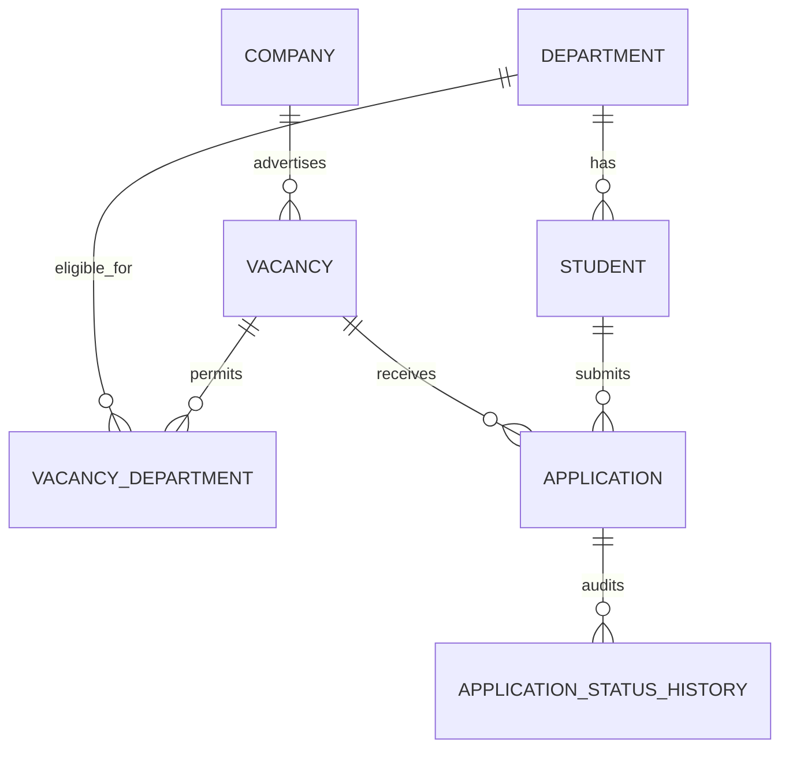

# Database Design

## Relational schema
`DEPARTMENT(department_id PK, name UQ)`; `STUDENT(student_id PK, department_id FK, email UQ, ...)`; `COMPANY(company_id PK, name UQ, ...)`; `VACANCY(vacancy_id PK, company_id FK, ...)`; `VACANCY_DEPARTMENT(vacancy_id FK, department_id FK, PK(vacancy_id,department_id))`; `APPLICATION(application_id PK, student_id FK, vacancy_id FK, UNIQUE(student_id,vacancy_id), ...)`; `APPLICATION_STATUS_HISTORY(history_id PK, application_id FK, ...)`.

## Normalization
1NF: every field is atomic; skills are stored as a pragmatic comma-separated profile attribute (a production system may split it into a skills master and bridge). 2NF: the only composite-key relation, `vacancy_department`, contains no partial dependency. 3NF: department and company facts are separate; vacancy and application facts depend only on their keys, not on a non-key attribute.

## ER diagram

