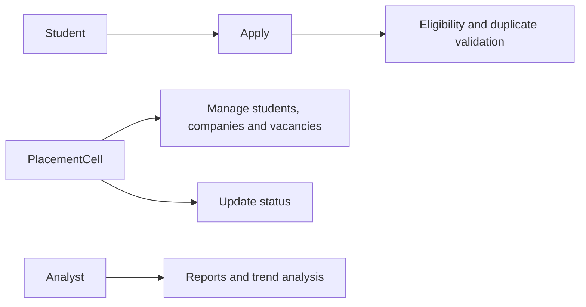
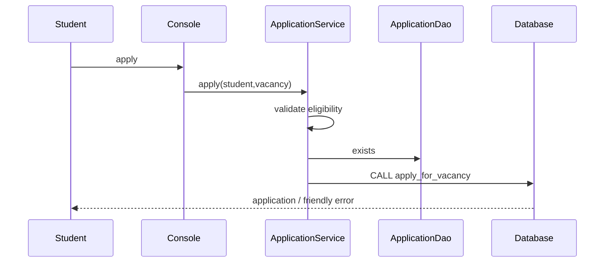
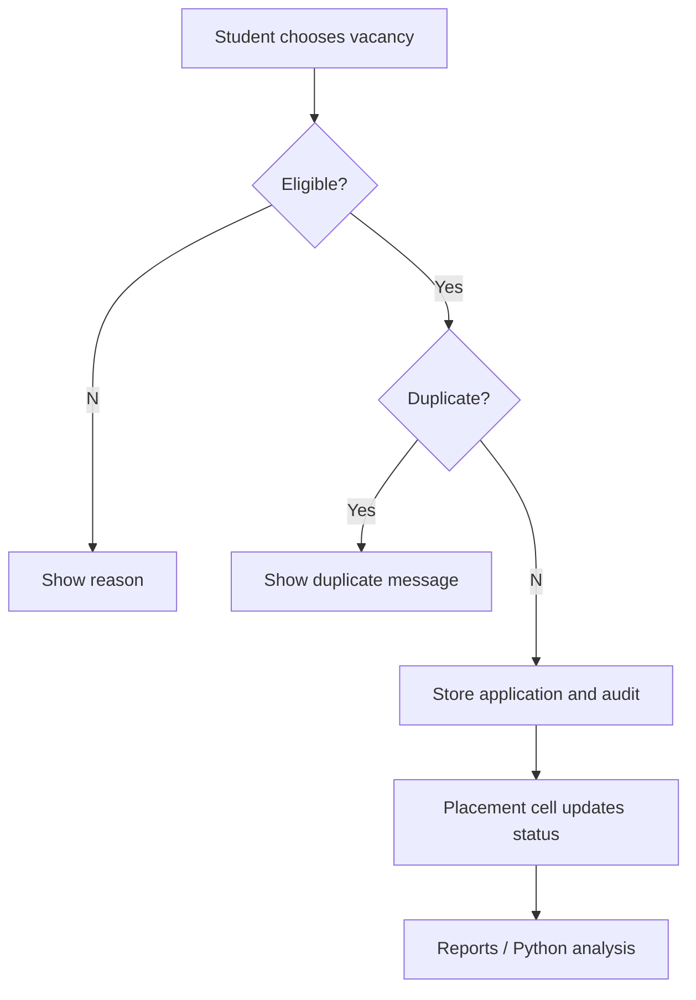

# Design Diagrams

## Use case

## Class diagram
```mermaid
classDiagram
 class Student {+id +cgpa +qualification} class Vacancy {+id +minCgpa +lastDate} class ApplicationService {+apply() +updateStatus()} class ApplicationDao {<<interface>> +exists() +apply() +updateStatus()} ApplicationService --> ApplicationDao
```
## Apply sequence

## Activity and DFD

Level 0: Student, placement cell and analyst exchange profile, vacancy, application and report data with the Job Portal. Level 1 decomposes the portal into profile management, vacancy management, application validation/status audit, reporting/export and analysis.
